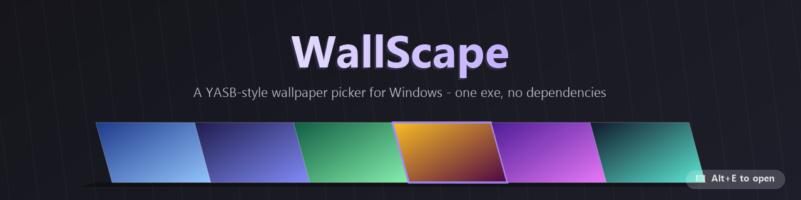

<p align="center">
  
</p>

A small, portable Windows wallpaper switcher with an animated change transition.
It recreates the wallpaper picker from YASB without needing YASB, a bar, Python,
or an installer.

- **Alt+E** opens a full-screen gallery of your wallpapers.
- Click a card to select it, click again (or press Enter) to apply, or glide two
  fingers across the touchpad / scroll the wheel to pan the row.
- The change plays a 1.2 second reveal animation over the desktop, icons stay put.
- Lives in the tray. Uses about 25-40 MB of RAM while idle.

Built as a single ~60 KB executable for the .NET Framework 4.8 that ships with
Windows 10 and 11. No SDK, runtime install, or administrator rights required.

## Requirements

- Windows 10 or Windows 11 (x64)
- Desktop "Animation effects" enabled for transitions
  (Settings → Accessibility → Visual effects → Animation effects)

## Build

The build uses the C# compiler that is already part of Windows:

```powershell
powershell -NoProfile -ExecutionPolicy Bypass -File .\build.ps1
```

This produces `WallScape.exe` and `WallScape.exe.config` in this folder.

## Use

1. Run `WallScape.exe`. On first launch it asks for one or more wallpaper folders.
   Folders are scanned recursively for PNG, JPG/JPEG, BMP, GIF and TIF/TIFF.
2. Press **Alt+E** (or double-click the tray icon) to open the gallery.
3. Choose a wallpaper with a double-click or **Enter**.

| Gallery action | Key / mouse |
| --- | --- |
| Select / apply | Click a card (click the selected card to apply), double-click, Enter |
| Pan the row | Mouse wheel, two-finger touchpad scroll (horizontal too) |
| Browse | ← / → |
| Jump a page | Page Up / Page Down |
| First / last | Home / End |
| Close | Esc, click outside, Alt+E again |
| Per-image menu | Right-click a thumbnail |

The tray menu also has **Change wallpaper (random)**, animation selection,
settings, and **Start with Windows** (off by default).

## Settings

The settings dialog edits wallpaper folders, the global hotkey, the transition
style and duration, and autostart. Everything is stored in `WallScape.ini` next
to the executable — nothing is written to AppData by WallScape.

```ini
[general]
hotkey=Alt+E
animation=circle          ; circle | slide_top | diamond | split | none
duration_ms=1200
hold_ms=220               ; final frame held before the overlay closes
autostart=0

[folders]
1=D:\Wallpapers
2=C:\Users\You\Pictures\Wallpapers

[gallery]
image_width=220           ; thumbnail width in DIPs
gap=16                    ; only used in the classic look
corner_radius=12          ; only used in the classic look
orientation=landscape     ; landscape | portrait
style=strip               ; strip (diagonal-cut edge-to-edge frames) | cards
lean=0                    ; diagonal cut size in DIPs, 0 = auto (22% of card height)
accent=auto               ; auto or #RRGGBB
dim=0.35                  ; dim of the desktop behind the gallery, 0-0.85

[cache]
max_mb=100
days=30
```

Thumbnails are cached in `cache\thumbs` next to the exe and pruned by age and
size. Deleting the `cache` folder is always safe.

## How it works

- **Gallery:** a layered window with per-pixel alpha, so the live desktop shows
  through the dimmed backdrop. One centered row, cached thumbnails, smooth slide.
- **Transition:** a frameless window is temporarily parented to the desktop's
  `WorkerW` window, which puts it above the wallpaper but below the icons. It
  paints the current wallpaper, then reveals the new one with the selected shape
  at 60 fps using an OutQuad curve. Only after the reveal finishes does Windows
  receive the new wallpaper, and the final frame is held briefly to hide the swap.
- **Fit mode:** the animation reads the Windows wallpaper style (fill, fit,
  stretch, center, tile, span) from the registry and reproduces the same layout,
  including transcode limits, so the hand-off to the real wallpaper is seamless.
- **Apply:** uses `IDesktopWallpaper` for the primary monitor, falling back to
  `SystemParametersInfo` if COM is unavailable.

Primary monitor only, as configured. The taskbar and secondary monitors are not
modified.

## Troubleshooting

**Alt+E does nothing.** Another running program already owns that hotkey. A tray
balloon reports this at startup; choose a different hotkey in Settings.

**The wallpaper changes instantly, without the animation.** Windows animation
effects are disabled, so the `WorkerW` window used for the overlay does not
exist. WallScape falls back to a normal wallpaper change. It also falls back if
the old or new image cannot be decoded, or if the source image is enormous and
the overlay cannot be built.

**The last frame does not line up with the real wallpaper.** This can happen
with unusual multi-monitor layouts or if the Windows style changes while the
animation runs. The wallpaper itself is still applied correctly; the transition
is only visual.

**The tray icon reports "No wallpapers found".** Add a folder in
Settings → Wallpaper folders. Empty folders and disconnected drives are ignored.

## Uninstall

Turn off **Start with Windows** in the tray menu, exit WallScape, then delete
this folder. The only registry change WallScape can make is the optional
`HKCU\Software\Microsoft\Windows\CurrentVersion\Run` value named `WallScape`.

## Notes

- Only one instance runs; launching a second copy opens the gallery of the first.
- WallScape is unsigned. If Windows SmartScreen warns, choose "More info" →
  "Run anyway", or build it yourself with the script above.
